# infoRouter Version 9 implementation guide

This guide takes you through the installation of infoRouter Version 9, screen by screen, and through what
is left to do after the setup program has finished. Follow the steps in the order they are given.

<!-- Screenshots: every picture on this page is a placeholder file in the images folder next to this page.
     To put a real screenshot in, capture it and save it over the placeholder with the same file name (PNG). -->

## Before you begin

### Read the requirements

Before you run the setup program, read the [system requirements](../system-requirements.md) and make sure
the server meets them. The setup program checks the server too, and does not continue on a server that does
not meet them.

### Check list

1. Log on to the server as "Administrator", or with an account that has full administration rights.
2. Make sure the server runs Windows Server 2019 or higher.
3. Make sure the "Web Server (IIS)" role is installed and IIS is running.
4. Have the database server ready: its name, and the user name and password of an account that may create a
   database or update an existing one.
5. Have your infoRouter Version 9 license file (`license.lic`) on the server.
6. Have the details of the SMTP server infoRouter will send its email through.
7. Download the setup program (the download link is sent to you by email) and double-click it to begin.

The ASP.NET Core Hosting Bundle and the two IIS features infoRouter needs (Request Filtering and Application
Initialization) do not have to be installed beforehand: when one is missing, the setup program offers to
install it.

## The setup program

### Welcome

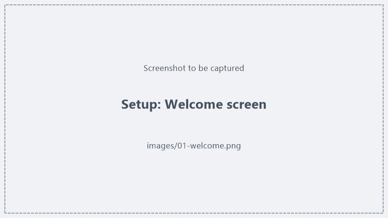

The first screen links to this guide. Check "I have read the implementation guide" and click "Next".

### Software requirements

The setup program checks the requirements of the server and lists each one with its status.

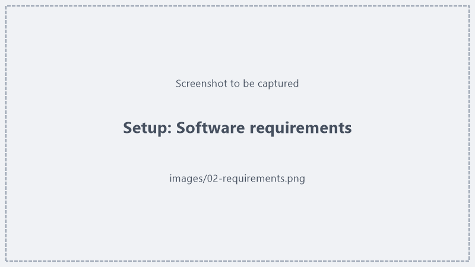

| Requirement | What to do when it is not installed |
|---|---|
| Windows Server 2016 or higher (2019 or higher for a new installation) | Install infoRouter on a server running Windows Server 2019 or higher. |
| Internet Information Server (IIS) 10 | Add the "Web Server (IIS)" role in Server Manager (Add Roles and Features), then run the setup program again. |
| ASP.NET Core Hosting Bundle | The setup program offers to install it. |
| Request Filtering | The setup program offers to add it. |
| Application Initialization | The setup program offers to add it. |

When a requirement cannot be met, the setup program says which one and what to do about it. Nothing has
been installed or changed on the server at that point.

Click "Next" to proceed.

### License agreement

Read the license agreement and check "I agree to the license agreement" to confirm that you have understood
and accepted the license terms.

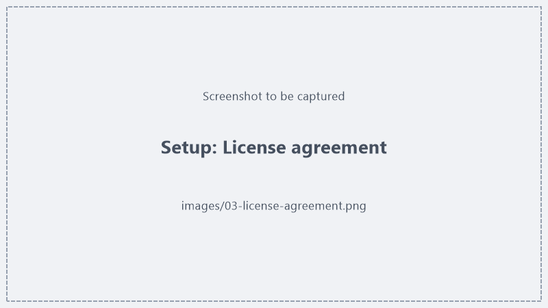

Click "Next" to proceed.

### Setup types and options

Choose between a new installation and the upgrade of an existing one.

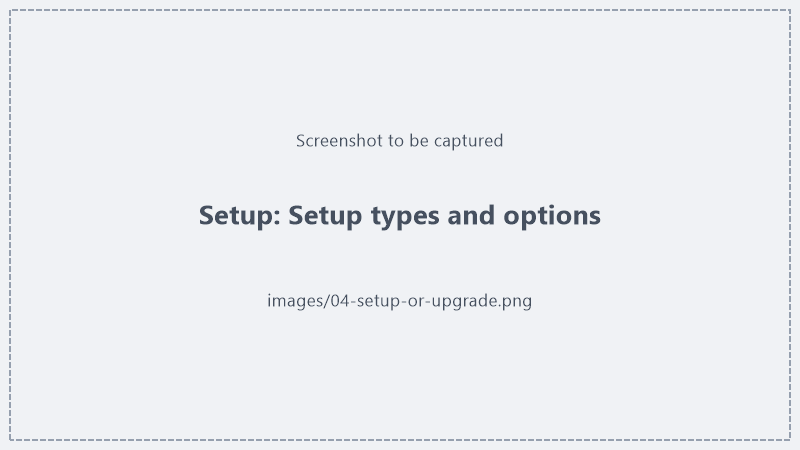

| Choice | What the setup program asks |
|---|---|
| New installation | The database platform: MS SQL Server, MySQL 8 or later, or Oracle 19c or later. The connection details are asked on a later screen. |
| Upgrade an existing installation | The application path of the existing installation (Version 7.2.215 or later, 8.x or 9.x). The setup program then checks the upgrade requirements. |

The rest of this guide follows a new installation.

Click "Next" to proceed.

### License

Select the license file that was sent to you with the download instructions. The setup program validates it
and shows its subscription dates.

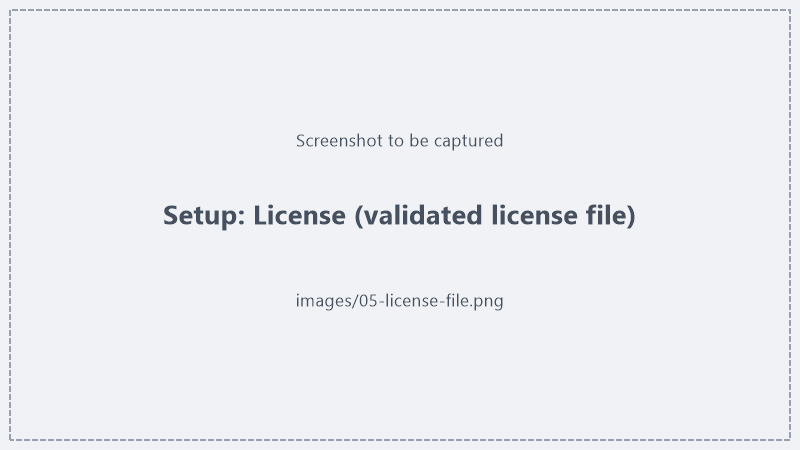

If the setup program says the license is invalid, check the permissions of the `license.lic` file. Copying
the file to the desktop or to a folder may change its security so that the setup program cannot read it. In
that case allow "Read" for "Everyone" on the file.

### Install paths

The setup program proposes default paths. Confirm them or choose others. We recommend the defaults where
possible.

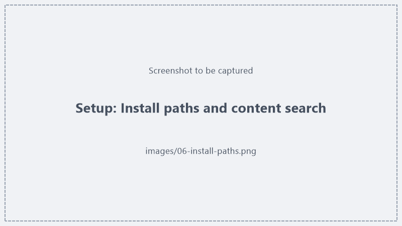

| Path | Default | Notes |
|---|---|---|
| Application path | `C:\InfoRouter` | Do **not** choose a root folder such as `C:\` or `D:\`. |
| Warehouse path | `C:\InfoRouter\WH` | Where the documents are stored. Do **not** choose a root folder. Choose a drive with room for the documents and their growth. |
| Temporary path | `C:\InfoRouter\Temp` | |

**Content search** is chosen on the same screen:

| Choice | Meaning |
|---|---|
| Use Windows Search | Offered when the Windows Search service is on the server. No setting is required. |
| Configure later | infoRouter is installed without content search. It can be set up afterwards, with Windows Search or with the infoRouter Search Service (dtSearch). |

### Database setup

The screen asks for the connection details of the database platform you chose. Make sure the version of the
database server meets the [system requirements](../system-requirements.md#supported-dbms-platforms).

#### MS SQL Server

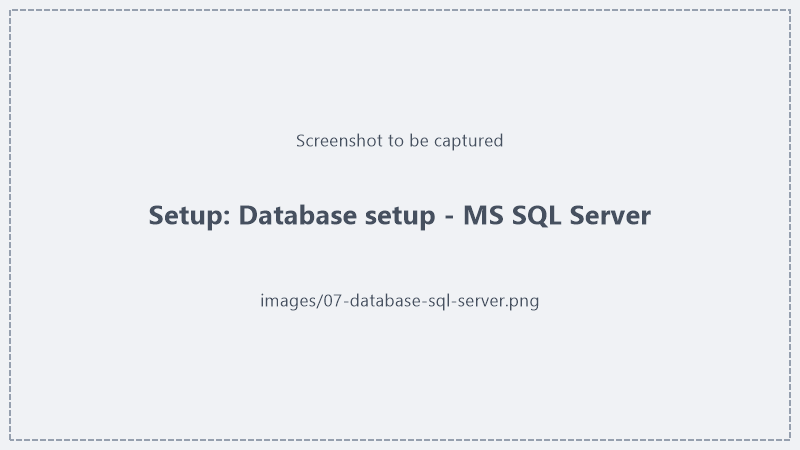

MS SQL Server needs an installed and working SQL Server instance, with authentication set to mixed mode.
Enter the server name, the user name and password of an account that may create the database, and the
database name (usually `infoRouter`).

#### MySQL

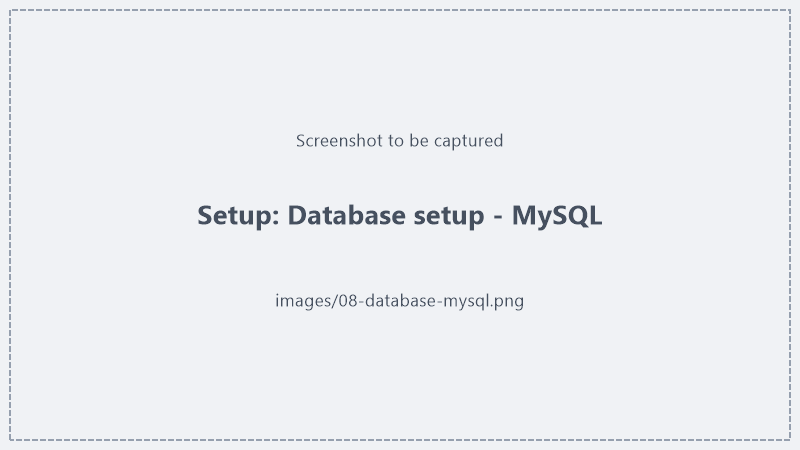

Enter the server name, the port number (3306 by default), the user name and password, and the database
name. MySQL must be version 8.0.28 or higher.

#### Oracle

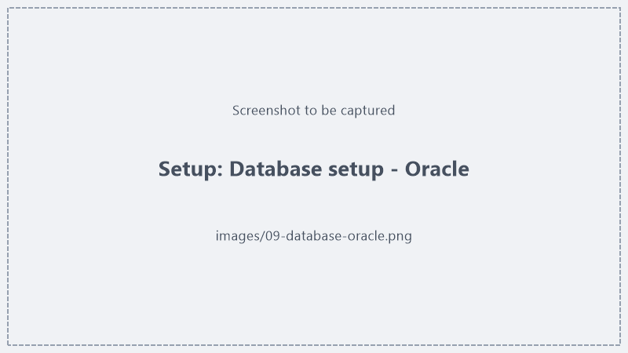

Oracle needs an installed and working Oracle Database server and an existing database (schema) set aside
for infoRouter. Enter the address of the Oracle server, and the user name and password of a user that may
manage that database.

For MS SQL Server and MySQL the setup program creates the infoRouter database when it does not exist. For
Oracle the database must exist already.

### IIS application configuration

Select the web site infoRouter is installed on from the list of IIS web sites, and choose how.

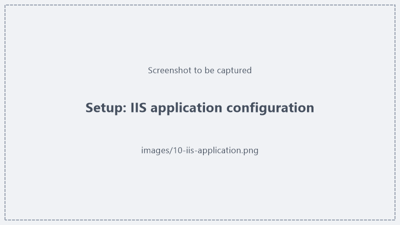

| Choice | Meaning |
|---|---|
| Create the infoRouter application on the selected web site | infoRouter is the web site. Required for WebDAV. |
| Create the infoRouter application as a virtual directory on the selected web site | infoRouter is reached under a name on the web site; the default name is `InfoRouter`. |

Make sure the "Application URL" is accurate and carries the name users reach the server by.

The setup program creates an application pool for infoRouter that runs as the Network Service account.

### SMTP configuration

infoRouter sends its email notifications through an SMTP server.

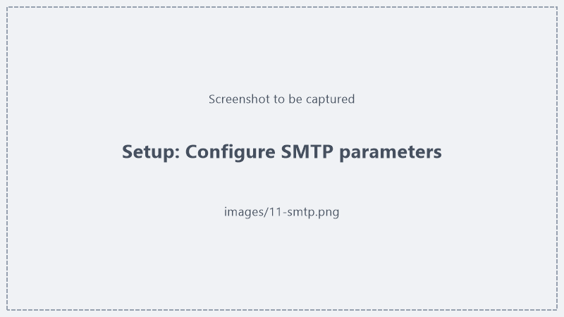

| Field | Notes |
|---|---|
| System email address | The sender of the notifications infoRouter sends. Use an address in your company's domain. It does not receive email from users. |
| Server name, port number | The SMTP server; port 25 by default. |
| Use SSL / TLS | Check it when the SMTP server requires an encrypted connection. |
| Account name, account password | Only when the SMTP server requires them. If the server does not require an account and you enter one, emails are likely to fail. |
| Connection timeout | In seconds; 10 by default. |

Make sure the SMTP server allows relay from the infoRouter server.

### Final settings

`sysadmin` is the predefined account infoRouter is administered with. Specify its password and its email
address.

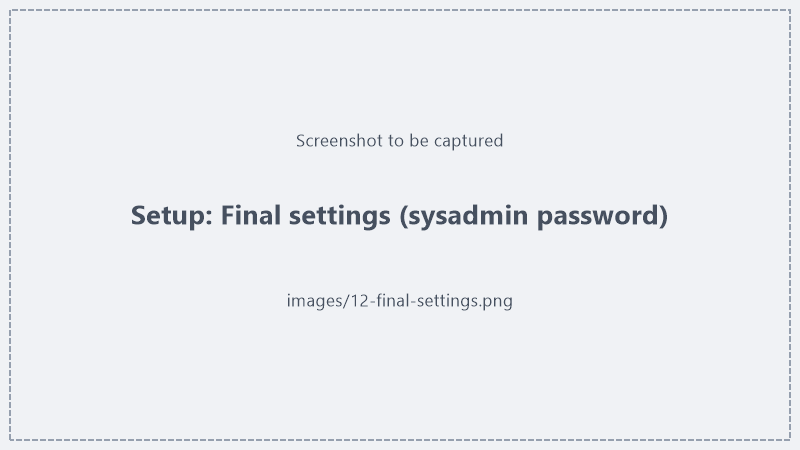

Choose a strong password and record it in a safe place. Enter a valid email address: the "Forgot password"
link of the login page sends the reset message to it.

### Finish install

The setup program is ready. Click "Finish" to install.

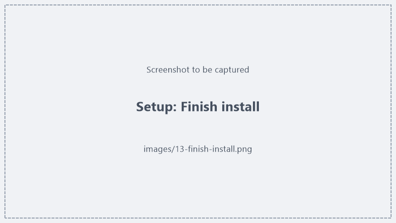

The setup program then:

1. Copies the setup files.
2. Connects to the database server.
3. Creates the database (MS SQL Server and MySQL, when it does not exist).
4. Inserts the default values and the application settings.
5. Creates the warehouse.
6. Creates the application in IIS.
7. Creates the content search catalog.
8. Applies the latest patch.

### Installation is complete

When the installation is complete, the setup program opens infoRouter in the browser.

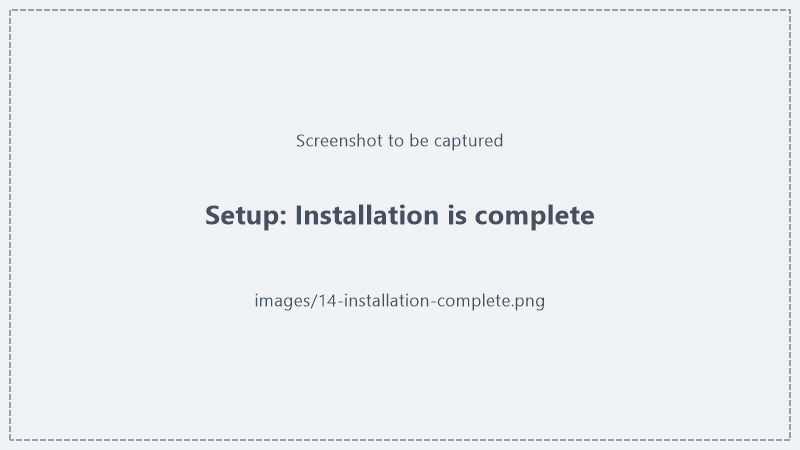

## Logging on to infoRouter

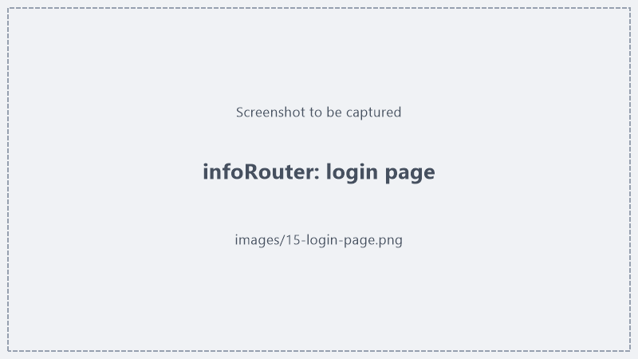

Log in as `sysadmin`, with the password you specified during the setup. It is the only account at this
point, and it has administrative rights.

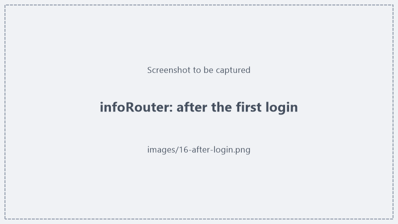

## After the installation

### Content search

With Windows Search, documents are searched by their content as far as the server has an iFilter for the
file format. Windows comes with iFilters for the Microsoft Office formats and for text formats such as HTML,
text and XML. For other formats (PDF, for example) install the iFilter of that format on the server.

For distributed and larger installations use the infoRouter Search Service (dtSearch) instead. It is a
separate Windows Service with its own installer and is licensed separately.

### Folder permissions

infoRouter runs as the Network Service account. That account must have Full Control of:

| Folder | Default |
|---|---|
| The infoRouter installation directory | `C:\InfoRouter` |
| The warehouse folder | `C:\InfoRouter\WH` |
| The infoRouter temporary directory | `C:\InfoRouter\Temp` |

The setup program gives these permissions on the paths you chose. Check them again when you move a path
later.

- Do not share the warehouse paths, and do not change the files in them: every change to a document must be
  made by infoRouter.
- Do not use mapped drives for the warehouse. A mapped drive belongs to the user who created it and is not
  there after a restart of the server. Use a UNC path (`\\ServerName\ShareName`) instead.

### Implementing SSL

We recommend installing infoRouter in HTTP mode first, and implementing SSL as a second step once the
installation works.

1. Obtain a certificate from a certificate provider and bind it to the infoRouter web site in IIS.
2. Test that the site answers on `https://`.
3. Change the application URL of infoRouter from `http://server_name/...` to `https://server_name/...`.

Obtaining and installing the certificate is outside the scope of this guide and is not a support service we
provide.

### Backups

You must have a backup strategy for infoRouter: the database and the warehouse, backed up together and
verified regularly. In the event of a hardware failure or a disaster, your backups may be the only source of
recovery. You are responsible for keeping regular and verified backups.

### Ongoing maintenance

- **infoRouter updates.** New releases and patches are announced to the technical contact we have on file
  for you. Read these announcements and apply the updates with Live Update, so that the system stays on the
  latest version.
- **A system administrator.** Designate an administrator for the regular tasks: running Live Update,
  maintaining the system recycle bin, managing users.
- **Operating system and database.** You are responsible for the Windows Server and the database server
  infoRouter runs on. Follow the updates and patches of their vendors and apply them in time, and have
  maintenance jobs for the database (optimization, disk space, performance monitoring). We do not provide
  support for the underlying operating system or database platform.

## Support

Email: [support@inforouter.com](mailto:support@inforouter.com)
